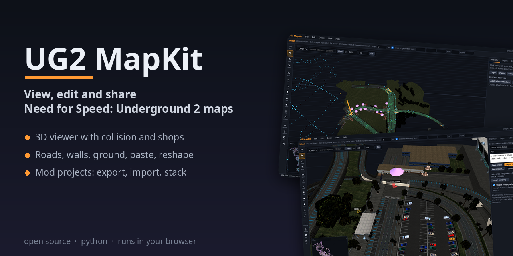
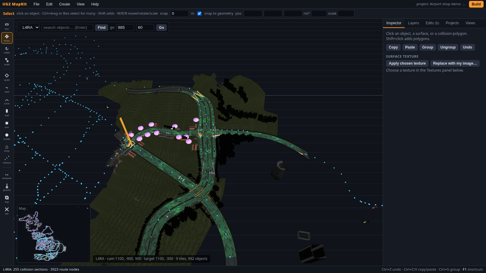
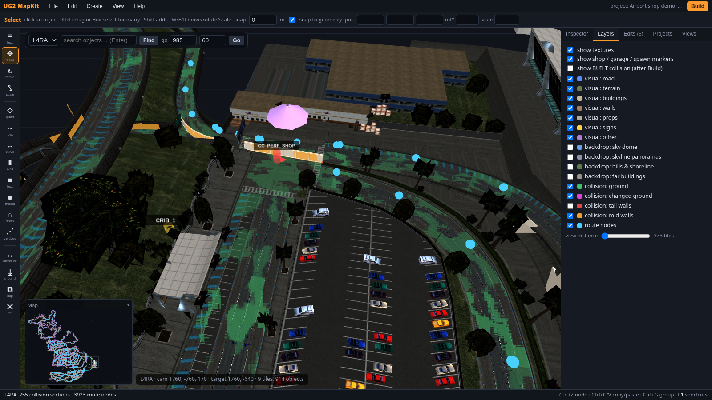
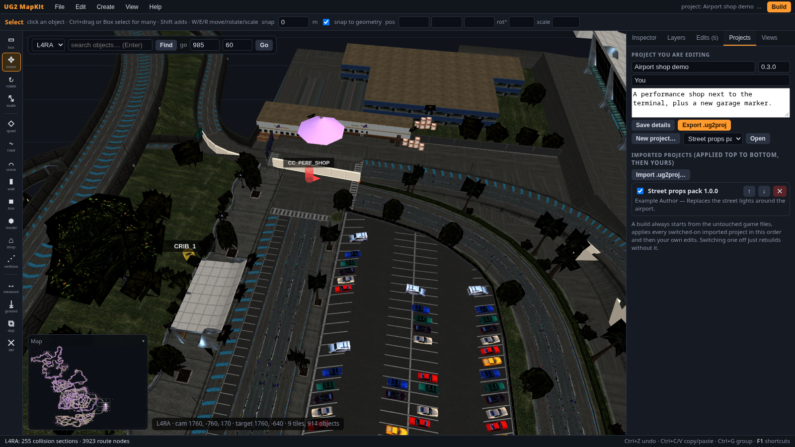
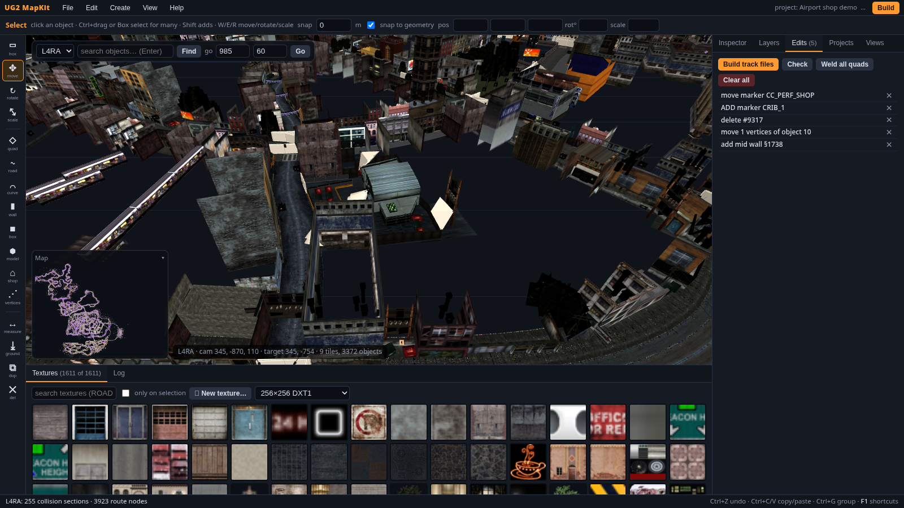

<p align="center"></p>

# UG2 MapKit

A viewer, editor and mod-project builder for the **Need for Speed: Underground 2** (PC) world. It runs on your computer, opens in your browser, reads the game's map files and writes modified copies back. It contains **no game files**: you need your own copy of the game.

> **Status: early / experimental.** Most features were tested in the game, but not all (see [What works](#what-works)). Always keep a backup of your game files. The tool backs up every file it replaces, but a bug report beats a broken install.

<p align="center">
 <br>
 
</p>

## What you can do

* **Look around** the whole free-roam city in 3D: objects, textures, the collision (ground, walls), route nodes, backdrops and the shop / garage / spawn markers.
* **Edit** the map: move, rotate, scale, hide and copy objects; draw roads, curved roads, quads and walls that you can actually drive on; reshape objects by dragging their vertices; paste parts of any other region (circuits, drag strips...) into the city including their ground and walls; retexture with your own images; add imported OBJ models.
* **Browse and place** from a catalogue of every model in the map, jump to shops and spawn points with *places…*, and start the game from the editor (`--launch`).
* **Reshape meshes** by vertex, edge or face, or round-trip a selection through **Blender** (OBJ export / import) and set the **surface type** of collision polygons.
* **Tweak AI / race routes** (experimental) and **explore the raw data** (hex / float browser with checked patches) for settings that are not mapped yet.
* **Snap** new surfaces to the existing ground, roads and models so they join without gaps.
* **Share your work as a project.** A project is a small package of *changes* (no game data). Others import it, switch it on or off, combine it with other projects and build the result from their own copy of the game. See [docs/PROJECTS.md](docs/PROJECTS.md).
* **Build and install**: only the changed files are written; originals are backed up and can be restored with one click.

## Quick start

```
git clone https://github.com/ps1ke/UG2-MapKit.git
cd UG2-MapKit
python3 -m venv .venv && source .venv/bin/activate      # Windows: .venv\Scripts\activate
pip install -r requirements.txt
python -m ug2map serve "<copy of the game's TRACKS folder>" --workspace ~/ug2-workspace
```

Or just run `start.sh` / `start.bat`: it sets everything up and asks for the game folder once.

Open <http://127.0.0.1:8765/>. (The viewer tells you when a newer version is on GitHub; `--no-update-check` turns that off.) The full guide, including the safe-copy recommendation and `--install`, is in **[docs/INSTALL.md](docs/INSTALL.md)**. How to use the editor: **[docs/USAGE.md](docs/USAGE.md)**.

## Projects in one minute

1. *Projects* tab → **New project…** and edit the map. Everything you do is stored in that project.
2. **Export .ug2proj** to share it. It contains your edits and your own textures/models, nothing from the game.
3. A friend uses **Import .ug2proj…**, ticks it, orders it, presses **Build**. Conflicts between projects are listed in the build report; the project lower in the list wins.

## What works

Verified in the game (Windows build running under Wine): hiding / moving objects and props, new drivable roads and quads with solid ground, walls, retexturing, imported models, vertex editing, pasting circuit areas with ground and walls, moving shop markers (the minimap pointer follows), the project build pipeline.

Known gaps:

* **Fog, rain (e.g. bridges where it must not fall), sound echo zones and weather cannot be edited by name yet**: the game has them, but where the values sit in the map files is not mapped. The *Data* tab exists to find them (see [docs/FORMATS.md](docs/FORMATS.md)).
* AI route editing only moves node positions (experimental).
* **Adding a working shop or garage is not solved.** Markers can be moved and added, but the drive-in zone and door of a shop are separate data and the code that opens the shop menu is not understood yet ([docs/FORMATS.md](docs/FORMATS.md)).
* The 3D view shows only the project you are editing, not the imported ones. Use *show BUILT collision* and test in the game.
* New textures are identified by name; two projects adding the same name collide (the build warns).
* Only region `L4RA` (the city) is edited by the viewer's tools in depth; other regions can be viewed and used as paste sources.
* No automatic tests against the real game: please report crashes together with the project and the build report.

## Documentation

| | |
|---|---|
| [docs/INSTALL.md](docs/INSTALL.md) | installation, safe copy, troubleshooting |
| [docs/USAGE.md](docs/USAGE.md) | the editor, tools and shortcuts |
| [docs/PROJECTS.md](docs/PROJECTS.md) | project format, import / export, stacking, conflicts |
| [docs/FORMATS.md](docs/FORMATS.md) | what is known about the world files |
| [CONTRIBUTING.md](CONTRIBUTING.md) | development and bug reports |

## Legal

MIT licensed ([LICENSE](LICENSE)). *Need for Speed* and *Underground* are trademarks of Electronic Arts Inc.; this project is not affiliated with or endorsed by EA. It does not contain or distribute any game data, and projects made with it must not either (a project holds edits and your own assets only). Screenshots show the game's map for illustration. Use it on your own copy of the game, at your own risk.
